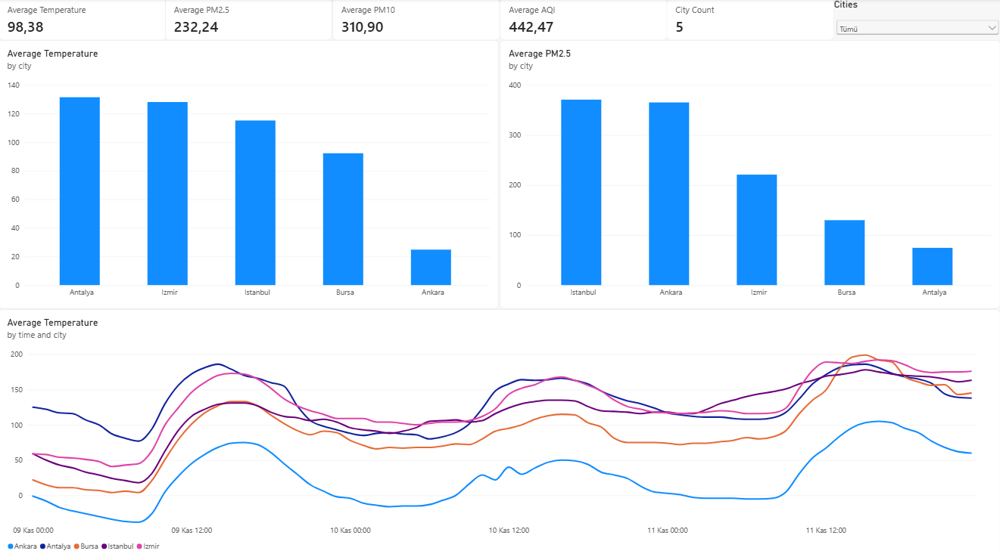
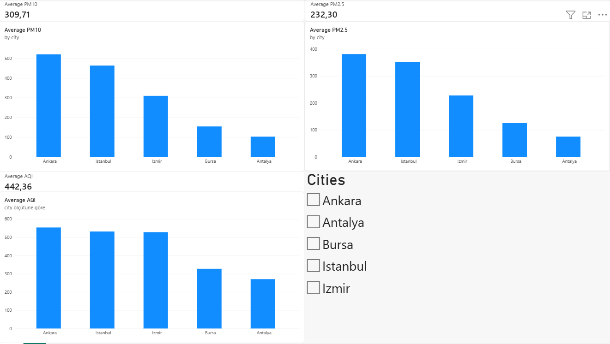
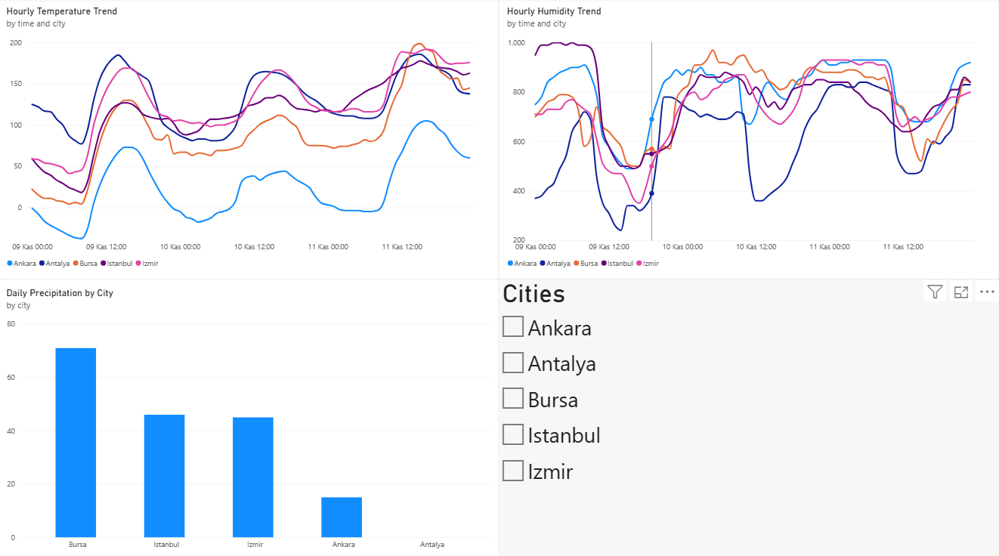

# 🇹🇷 Turkey Weather & Air Quality Analytics

An end-to-end data analytics project that collects, processes, analyzes, and visualizes weather and air quality forecast data for five major cities in Türkiye using Python, Pandas, Open-Meteo APIs, and Microsoft Power BI.

The project demonstrates data collection through APIs, data cleaning, exploratory data analysis, statistical analysis, data visualization, business intelligence reporting, and automated data pipeline execution with GitHub Actions.

## 📊 Power BI Dashboard

### 1. Overview



### 2. Air Quality Analysis



### 3. Weather Trends



## 🎯 Project Objectives

- Collect weather and air quality forecast data from public APIs.
- Analyze environmental conditions across five major Turkish cities.
- Clean and prepare raw data using Python and Pandas.
- Identify statistical outliers and analyze relationships between variables.
- Generate meaningful KPIs and visual reports.
- Build an interactive Power BI dashboard.
- Automate daily data collection and processing using GitHub Actions.

## 🏙️ Cities Covered

The project analyzes five cities in Türkiye:

- Istanbul
- Ankara
- Izmir
- Antalya
- Bursa

## 🛠️ Technologies & Tools

| Technology         | Purpose                               |
| ------------------ | ------------------------------------- |
| Python 3.12        | Data processing and automation        |
| Pandas             | Data cleaning and analysis            |
| NumPy              | Numerical operations                  |
| Matplotlib         | Data visualization                    |
| Seaborn            | Statistical visualization             |
| Open-Meteo API     | Weather and air quality forecast data |
| Microsoft Power BI | Interactive dashboards and reporting  |
| DAX                | KPI calculations and measures         |
| Git & GitHub       | Version control and project hosting   |
| GitHub Actions     | Automated daily data pipeline         |

## 📡 Data Sources

This project uses the following public APIs:

- [Open-Meteo Weather Forecast API](https://open-meteo.com/en/docs)
- [Open-Meteo Air Quality API](https://open-meteo.com/en/docs/air-quality-api)

The APIs provide hourly forecast data for weather and air quality variables.

### Key Variables

**Weather Data**

- Temperature
- Relative humidity
- Precipitation

**Air Quality Data**

- PM2.5
- PM10
- European Air Quality Index (European AQI)

## ⚙️ Data Pipeline

The project follows an automated data processing workflow:

1. **Data Collection:** Retrieve hourly weather and air quality forecast data from Open-Meteo APIs.
2. **Data Storage:** Save raw API responses in JSON format.
3. **Data Cleaning:** Handle missing values, standardize data, and prepare a cleaned dataset.
4. **Data Analysis:** Calculate city-level KPIs, daily metrics, correlations, and statistical outliers.
5. **Data Visualization:** Generate charts and statistical visualizations.
6. **Business Intelligence:** Present key findings through interactive Power BI dashboards.
7. **Automation:** Execute the pipeline daily using GitHub Actions.

## 📁 Project Structure

```text
turkey-weather-analytics/
│
├── data/
│   ├── raw/
│   └── processed/
│       └── cleaned_weather_air_quality.csv
│
├── src/
│   ├── main.py
│   ├── data_cleaning.py
│   ├── data_analysis.py
│   └── visualization.py
│
├── notebooks/
│
├── powerbi/
│
├── reports/
│   ├── figures/
│   ├── dashboard/
│   ├── city_kpis.csv
│   ├── daily_metrics.csv
│   ├── correlation_matrix.csv
│   ├── outlier_report.csv
│   └── data_quality_report.csv
│
├── .github/
│   └── workflows/
│       └── update-data.yml
│
├── requirements.txt
├── .gitignore
└── README.md
```

## 🚀 Getting Started

### 1. Clone the Repository

```bash
git clone https://github.com/furkankucuk61/turkey-weather-analytics.git
```

```bash
cd turkey-weather-analytics
```

### 2. Create a Virtual Environment

```bash
python -m venv .venv
```

Activate it on Windows:

```bash
.venv\Scripts\activate
```

### 3. Install Dependencies

```bash
pip install -r requirements.txt
```

### 4. Run the Data Pipeline

Execute the scripts in the following order:

```bash
python src/main.py
```

```bash
python src/data_cleaning.py
```

```bash
python src/data_analysis.py
```

```bash
python src/visualization.py
```

After execution, processed datasets, analysis reports, and visualization files will be generated in the relevant directories.

## 📈 Key Analysis & Reports

The project generates several analytical outputs:

| Report                      | Description                               |
| --------------------------- | ----------------------------------------- |
| `city_kpis.csv`           | City-level performance indicators         |
| `daily_metrics.csv`       | Daily weather and air quality metrics     |
| `correlation_matrix.csv`  | Relationships between numerical variables |
| `outlier_report.csv`      | Statistical outlier detection             |
| `data_quality_report.csv` | Data quality checks                       |

Generated visualizations include:

- Average temperature comparison
- Average PM2.5 comparison
- Temperature trends
- Correlation heatmap

## 📊 Power BI Dashboard Features

The Power BI report contains three analytical pages:

**Overview**

- Average temperature
- Average humidity
- Total precipitation
- Average PM2.5
- Average PM10
- Average European AQI
- City comparison

**Air Quality Analysis**

- PM2.5 and PM10 analysis
- European AQI comparison
- City-level air quality trends

**Weather Trends**

- Temperature trends
- Humidity analysis
- Precipitation analysis
- City comparisons

## 🔄 Automated Data Updates

GitHub Actions runs the data pipeline automatically every day.

The workflow:

- Retrieves the latest forecast data.
- Processes and cleans the collected data.
- Generates analytical reports and visualizations.
- Commits updated datasets and reports to the repository.

The workflow can also be triggered manually from the GitHub Actions tab.

**Note:** Power BI Desktop uses the processed CSV hosted in this GitHub repository. The report can be updated manually using the Refresh option in Power BI Desktop. Power BI Service scheduled refresh is not currently configured.

## 🔍 Methodology & Limitations

- The dataset contains hourly forecast data, not historical measured observations from weather stations.
- Air quality values are API-provided forecasts and should not be interpreted as direct monitoring-station measurements.
- Statistical outliers are flagged for further investigation and are not automatically removed.
- Correlation analysis identifies statistical relationships and does not establish causation.
- Forecast accuracy may vary depending on location and forecast conditions.

## 💡 Future Improvements

- Historical weather and air quality data integration.
- Advanced statistical analysis and forecasting.
- More detailed city-level comparisons.
- Additional interactive Power BI features.
- Automated data quality monitoring.
- Extended trend analysis over longer periods.

## 👨‍💻 Author

**Furkan Küçük**

Data Analytics | Python | SQL | Power BI

[github.com/furkankucuk61](https://github.com/furkankucuk61)

---

*This project was developed as a practical data analytics portfolio project to demonstrate end-to-end data collection, processing, analysis, visualization, and automation skills.*
